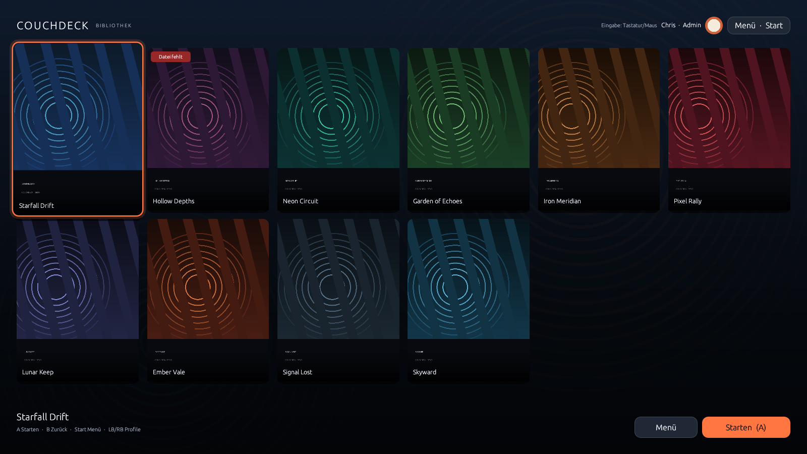

# CouchDeck

CouchDeck ist ein nativer, controller-first Fullscreen-Game-Launcher für **Bazzite / KDE Plasma / Wayland**. Die App startet direkt in eine persönliche Spielebibliothek – kein Shop, keine News, keine Cloud, kein Overlay und keine Spieleplattform-Accounts.

**Aktuelle Version:** 0.2.0 · **Sprache:** Deutsch · [English](README.md)

Gespielt wird ausschließlich über vorhandene `.desktop`-Dateien und `gio launch`. Coverbilder werden getrennt von den Desktop-Dateien in CouchDeck verwaltet; die Originaldateien werden nie verändert.



## Funktionsumfang

- **Fullscreen-Bibliothek** mit Cover-Grid, 3:4-Center-Crop, Fokusanimation und Fallback-Reihenfolge eigenes Cover → Desktop-Icon → neutrale Kachel.
- **Gamepad-Navigation** über `gilrs`: D-Pad und linker Stick mit Deadzone, Hold-Repeat, Debouncing und Hotplug. South = bestätigen/starten, East = zurück, Start = Menü. LB/RB öffnen die Profilübersicht; dort wird zwischen Profilen gewechselt.
- **Tastatur und Maus parallel**: Pfeiltasten, Enter/Leertaste, Escape, M, F11, Mausklick und Doppelklick.
- **Desktop-Dateien**: XDG-Discovery, Import beliebiger Dateien, Vorschau von Name, Pfad und rohem `Exec`-Inhalt, Unterstützung für `NoDisplay`, `Hidden`, `TryExec`, `Path`, `DBusActivatable`, Kategorien und lokalisierte Namen.
- **Start über GIO**: ausschließlich `gio launch /absoluter/pfad.desktop`. `Exec=` wird nicht zum Starten interpretiert; der rohe Inhalt dient nur der Anzeige und Diagnose.
- **Eigene Artwork-Verwaltung**: Cover, Spiel-Hintergrund und globales Hintergrundbild per Dateiauswahl; Import nach `$XDG_DATA_HOME/couchdeck/assets/`, Vorschaucache unter `$XDG_CACHE_HOME/couchdeck/`.
- **Lokale Profile**: Anzeigename, Rolle (Admin/Spieler), Avatar, profilabhängige Sichtbarkeit von Spielen. Keine Linux-Konten, keine Cloud.
- **Admin-Bereich**: Spiele importieren/ausblenden/entfernen/sortieren, Titel und Artwork ändern, Profile verwalten, Sichtbarkeit je Profil, Einstellungen, PIN-Verwaltung.
- **Admin-PIN**: Argon2id-Hash in separater Datei mit Modus `0600`; Eingabe per Tastatur und On-Screen-Ziffernfeld mit Controller. Der Profilwechsel selbst ist keine Authentifizierung; Admin-Aktionen werden bei gesetzter PIN separat entsperrt.
- **Steam-Flatpak-Reparatur**: erkennt `Exec=steam steam://rungameid/ID`, ändert nichts automatisch und erzeugt nach ausdrücklicher Bestätigung eine **separate verwaltete** Datei mit `flatpak run com.valvesoftware.Steam …`.
- **Prism-Launcher**: Import vorhandener Instanz-Desktop-Dateien; zusätzlich kann CouchDeck eine verwaltete Datei mit `flatpak run org.prismlauncher.PrismLauncher --launch INSTANCE_ID` erzeugen. `INSTANCE_ID` ist der Instanzordner, nicht der sichtbare Name.
- **Autostart (Opt-in)**: CouchDeck kann sich als KDE-only XDG-Autostart-Eintrag eintragen und startet dann rahmenlos im Vollbild. Der Steam Gaming Mode/Gamescope wird über `OnlyShowIn=KDE;` bewusst nicht gestartet. Der Eintrag kann über Admin → Einstellungen oder `install-user.sh --autostart` verwaltet werden.
- **Zu KDE minimieren**: verlässt zuerst den Fullscreen und minimiert dann das Fenster, damit KDE/Panel/Taskleiste zuverlässig erreichbar bleiben.
- **Power-Menü**: CouchDeck beenden, System neu starten oder herunterfahren – mit Bestätigungsdialog und festen `systemctl`-Aufrufen (kein Shell-Einsatz).
- **Robuste Persistenz**: atomisches Schreiben, Backups bei beschädigten Dateien, keine stillen Überschreibungen, Logs unter `$XDG_STATE_HOME/couchdeck/`.

Weitere Screenshots: [Profilansicht](docs/screenshots/profiles.png), [Bibliothek als Spielerprofil](docs/screenshots/library-profile-mia.png), [Admin](docs/screenshots/admin.png), [Spieleeditor](docs/screenshots/game-editor.png), [Import](docs/screenshots/import.png), [PIN-Pad](docs/screenshots/pinpad.png), [Start-Overlay](docs/screenshots/launch.png), [Power-Menü](docs/screenshots/menu.png), [Autostart-Einstellungen](docs/screenshots/autostart-settings.png), [Beschädigte Daten](docs/screenshots/corrupt-data.png).

## Voraussetzungen

- Bazzite mit KDE Plasma auf Wayland (Zielsystem).
- GLib/GIO (`gio`), ein funktionierendes OpenGL-Setup und udev/libudev für `gilrs`.
- systemd/logind mit `systemctl` für Neustart/Herunterfahren (auf Bazzite vorhanden); Polkit muss die Aktion für die aktive Sitzung erlauben.
- Rust stable **≥ 1.85**. Getestet mit Rust 1.89.
- Kein root, kein `rpm-ostree`-Layer, kein Flatpak für CouchDeck selbst.
- Für Steam-/Prism-Integrationen müssen die jeweiligen Flatpaks auf dem Host installiert sein.

## Build auf Bazzite (Distrobox)

Bitte ein Fedora-Basisimage passend zur **Host-Fedora-Version** verwenden, damit die glibc im Container nicht neuer ist als auf dem Host.

```bash
# Auf dem Host
grep -E '^(NAME|VERSION_ID)=' /etc/os-release

# Beispiel: Host ist Fedora 42
distrobox create \
  --name couchdeck-build \
  --image registry.fedoraproject.org/fedora-toolbox:42

# Falls der toolbox-Tag für euer Release fehlt:
#   --image registry.fedoraproject.org/fedora:42

distrobox enter couchdeck-build
```

Im Container:

```bash
sudo dnf install -y \
  cargo rust clippy rustfmt gcc gcc-c++ pkgconf-pkg-config \
  systemd-devel libxkbcommon-devel wayland-devel mesa-libGL-devel \
  libX11-devel libXcursor-devel libXrandr-devel libXi-devel

cd /pfad/zu/couchdeck
cargo build --release
cargo test
cargo clippy --all-targets -- -D warnings
cargo fmt --check
```

Falls das Fedora-`rust`-Paket älter als 1.85 ist, im Container rustup verwenden:

```bash
curl --proto '=https' --tlsv1.2 -sSf https://sh.rustup.rs | sh -s -- -y --profile minimal
source "$HOME/.cargo/env"
```

`Cargo.lock` wird mitgeliefert und pinnt die getesteten Versionen (u. a. `eframe 0.32.3`, `gilrs 0.11.2`, `image 0.25.10`, `argon2 0.5.3`).

## Installation ohne root

Nach dem Release-Build auf dem **Host** (nicht im Container) aus dem Repo:

```bash
./scripts/install-user.sh
# optional direkt mit KDE-Autostart:
./scripts/install-user.sh --autostart
```

Das installiert:

- `~/.local/bin/couchdeck`
- `~/.local/share/applications/couchdeck.desktop`
- `~/.local/share/icons/hicolor/scalable/apps/couchdeck.svg`

Start über die KDE-Anwendungsliste oder:

```bash
~/.local/bin/couchdeck
```

Entwicklung/Debug:

```bash
~/.local/bin/couchdeck --windowed          # Fenster statt Vollbild
~/.local/bin/couchdeck --no-controller     # Gamepad-Thread deaktivieren
~/.local/bin/couchdeck --help
```

Deinstallation ohne Datenverlust:

```bash
./scripts/uninstall-user.sh
```

Vollständige Löschung von Bibliothek, Profilen, PIN-Hash, Artwork, Cache und Logs nur nach expliziter Bestätigung:

```bash
./scripts/uninstall-user.sh --purge
```

## Bedienung

| Aktion | Controller | Tastatur/Maus |
|---|---|---|
| Fokus bewegen | D-Pad / linker Stick | Pfeiltasten, Maus |
| Starten / bestätigen | A (South) | Enter / Leertaste, Doppelklick |
| Zurück / schließen | B (East) | Escape |
| Menü | Start | M |
| Profile wechseln | LB/RB (öffnet Profilansicht, dort wechseln) | PageUp/PageDown |
| Zu KDE minimieren | Menü → Zu KDE minimieren | Menü |
| Vollbild umschalten | – | F11 |
| System neu starten / herunterfahren | Menü → System … | Menü |
| CouchDeck beenden | Menü → CouchDeck beenden | Strg+Q |

Die Bibliothek zeigt nur Cover, Titel und bei Fokus eine reduzierte Aktionsleiste. LB/RB öffnen aus der Bibliothek die Profilübersicht; direkt gewechselt wird dort.

## Autostart, Kiosk-Betrieb und Systemaktionen

CouchDeck ist für einen KDE-Plasma-Desktop unter Wayland gedacht, nicht für den Steam Gaming Mode. Der Autostart-Eintrag enthält deshalb `OnlyShowIn=KDE;` und wird in einer Gamescope-/Gaming-Mode-Sitzung ignoriert.

- **Autostart aktivieren**: Admin → Einstellungen → „Beim Anmelden automatisch starten (nur KDE)“. Alternativ `./scripts/install-user.sh --autostart`.
- **Autostart-Datei**: `$XDG_CONFIG_HOME/autostart/couchdeck.desktop` (normalerweise `~/.config/autostart/couchdeck.desktop`).
- **Vollbild-Overlay**: Beim Start wird das Fenster rahmenlos im Vollbild geöffnet. KDE bleibt im Hintergrund aktiv.
- **Zu KDE**: Das Menü „Zu KDE minimieren“ beendet zuerst den Vollbildmodus und minimiert danach das Fenster. Über die KDE-Taskleiste kann CouchDeck wiederhergestellt werden. Falls ein Wayland-Compositor das Minimieren ignoriert, ist das Fenster bereits im Fenstermodus und bleibt über Taskleiste/Alt+Tab erreichbar.
- **Beenden**: „CouchDeck beenden“ im Start-Menü beendet nur den Launcher, keine bereits gestarteten Spiele.
- **Neu starten / Herunterfahren**: CouchDeck fragt vorher nach und ruft anschließend `systemctl --no-block --no-wall reboot` bzw. `systemctl --no-block --no-wall poweroff` auf. Die Berechtigung wird von systemd/logind über Polkit geprüft; eine Polkit-Abfrage kann erscheinen.

Der Autostart ist eine bewusste Opt-in-Funktion und wird bei der Deinstallation über `scripts/uninstall-user.sh` entfernt. Die Bibliothek, Profile und Artwork bleiben dabei erhalten.

## Erste Schritte

1. **Admin-Bereich öffnen**: Menü → Admin-Bereich. Beim ersten Start ist ein lokales Admin-Profil `Spieler 1` vorhanden. Name und Avatar lassen sich unter Admin → Profile ändern.
2. **Spiel importieren**: Admin → Spiele → *Desktop-Datei importieren*. Name, Pfad und roher `Exec`-Inhalt werden vor der Freigabe angezeigt. Alternativ eine beliebige Datei über den Dateibrowser auswählen.
3. **Cover setzen**: Spiel auswählen → *Cover wählen*. Das Bild wird kopiert und als eigener Override gespeichert; `Icon=` in der `.desktop`-Datei bleibt unverändert.
4. **Admin-PIN setzen** (empfohlen): Admin → PIN & Sicherheit → *PIN setzen*. Die PIN ist eine lokale UI-Sperre, keine Betriebssystem-Sicherheitsgrenze.
5. **Starten**: In der Bibliothek A/Enter drücken. CouchDeck übergibt die Datei an GIO und zeigt bewusst keinen „Spiel läuft“-Status.

## Steam und Prism

### Steam als Flatpak

Ein vorhandener Shortcut mit `Exec=steam steam://rungameid/12345` wird im Spieleeditor und unter Admin → Steam/Prism erkannt. CouchDeck ändert die Originaldatei nicht. Nach Bestätigung wird eine separate Datei unter `$XDG_DATA_HOME/couchdeck/managed-desktop/` erzeugt:

```ini
Exec=flatpak run com.valvesoftware.Steam steam://rungameid/12345
```

Der neue Eintrag wird zusätzlich in die Bibliothek aufgenommen; der ursprüngliche Eintrag bleibt erhalten. Ist `com.valvesoftware.Steam` nicht installiert, wird die Reparatur abgelehnt.

### Prism Launcher

Vorhandene `.desktop`-Dateien mit:

```ini
Exec=flatpak run org.prismlauncher.PrismLauncher --launch INSTANCE_ID
```

können direkt importiert werden. Beim Import wird geprüft, ob der Instanzordner existiert:

- `~/.var/app/org.prismlauncher.PrismLauncher/data/PrismLauncher/instances/<ID>`
- `~/.local/share/PrismLauncher/instances/<ID>`
- `~/.var/app/org.prismlauncher.PrismLauncher/.local/share/PrismLauncher/instances/<ID>`

`INSTANCE_ID` ist der **Ordnername**, nicht der sichtbare Instanzname. Unter Admin → Steam/Prism können vorhandene Instanzen ausgewählt und eine verwaltete Desktop-Datei erzeugt werden. Das Cover wird anschließend wie bei jedem anderen Eintrag gesetzt und ist völlig unabhängig vom Desktop-Icon.

Beispieldateien liegen unter `examples/`: `prism-minecraft.desktop`, `steam-game-flatpak.desktop`, `steam-game-original.desktop` und `library.example.json`.

## Datenformat und Speicherorte

| Zweck | Pfad |
|---|---|
| Einstellungen | `$XDG_CONFIG_HOME/couchdeck/settings.toml` |
| KDE-Autostart | `$XDG_CONFIG_HOME/autostart/couchdeck.desktop` |
| Bibliothek/Profile/Spiele | `$XDG_DATA_HOME/couchdeck/library.json` |
| PIN-Hashes | `$XDG_DATA_HOME/couchdeck/secrets.json` (Modus `0600`) |
| Importierte Bilder | `$XDG_DATA_HOME/couchdeck/assets/{covers,backgrounds,avatars}/` |
| Verwaltete Desktop-Dateien | `$XDG_DATA_HOME/couchdeck/managed-desktop/` |
| Thumbnail-Cache | `$XDG_CACHE_HOME/couchdeck/thumbnails/` |
| Logs | `$XDG_STATE_HOME/couchdeck/couchdeck.log` |

Details: [docs/DATA-FORMAT.md](docs/DATA-FORMAT.md).

## Sicherheitsmodell

- CouchDeck startet **nur** Dateien, die ein Admin explizit importiert hat. Beim Import werden Name, Pfad und `Exec` angezeigt.
- `Exec=` wird nie von CouchDeck ausgeführt oder zum Starten in Argumente zerlegt. Die Datei geht unverändert an `gio launch`; der rohe Inhalt wird nur lesend angezeigt und für Diagnosehinweise geprüft.
- Der Admin-Bereich und alle Änderungsaktionen sind nur für Admin-Profile sichtbar.
- Die PIN schützt vor versehentlichen Änderungen in der UI. Sie ist **keine echte OS-Sicherheitsgrenze**: Wer Zugriff auf dasselbe Linux-Benutzerkonto hat, kann die JSON-Dateien direkt ändern. Für echte Trennung separate Linux-Konten verwenden.
- Power-Aktionen werden nur nach einem Bestätigungsdialog ausgelöst. Es werden feste, argumentgetrennte `systemctl`-Aufrufe verwendet; keine Shell, keine freie Befehlsverkettung.
- Keine Netzwerkabhängigkeit, keine Cloud, keine Telemetrie, keine externen Downloads.

## Architektur

```
main.rs        CLI, Logging, eframe-Start, Viewport
app.rs         Zustandsmaschine, Navigation, Aktionen, Persistenz-Orchestrierung
model.rs       Library/Profile/GameEntry/Settings/AdminSecrets
storage.rs     XDG-Persistenz, atomisches Schreiben, Backups, Migration
paths.rs       XDG-Auflösung, Applikations-/Icon-Pfade
desktop.rs     Desktop-Parsing, Discovery, Icon-Auflösung, Steam-/Prism-Diagnose
launch.rs      GIO-Launch im Hintergrundthread, Fehlerdiagnose
power.rs       systemctl-Neustart/Herunterfahren, Polkit-Fehlerbehandlung
controller.rs  gilrs-Thread, Deadzone, Repeat, Hotplug, Input-Normalisierung
artwork.rs     Bildimport, Center-Crop, Thumbnail-Cache, Texturen
ui/            Bibliothek, Profile, Admin, Dialoge/Overlays
```

Datenfluss: `UI → AppState → Library/Profiles → GIO (gio launch)`.

## Bekannte Einschränkungen / noch auf Zielhardware zu testen

- **Nicht auf Bazzite getestet**: Entwicklung und automatisierte Tests liefen auf Manjaro/KDE/Wayland. Wayland-Fullscreen, KDE-Fokusverhalten, echte Controller-Hotplug-Szenarien, 4K/DPI und die NVIDIA-Wayland-Darstellung auf Bazzite müssen auf dem Zielgerät verifiziert werden.
- **Kein Controller in der Testumgebung**: Die Logik ist unit-getestet (`gilrs`-Mapping, Deadzone, Repeat); ein realer Xbox-/PlayStation-Controller wurde hier nicht angeschlossen. `--no-controller` und der Fall „kein Controller gefunden“ wurden geprüft.
- **Kein Spiel-Lebenszyklus**: `gio launch` ist nur ein Startbefehl. CouchDeck erkennt weder zuverlässig, ob ein Spiel läuft, noch wann es endet. Steam/Prism können im Hintergrund weiterlaufen.
- **Fokus nach Spielstart/-ende**: Plasma soll das Spielfenster in den Vordergrund holen. Das Verhalten wurde auf dem Zielgerät noch nicht geprüft. CouchDeck beendet keine Spiele und bietet ein explizites „Zu KDE minimieren“.
- **SVG-Desktop-Icons** werden nicht rasterisiert (kein SVG-Decoder eingebunden). PNG/WebP/JPEG-Icons und eigene Cover funktionieren; sonst greift die neutrale Kachel.
- **Kein Cover-Scraping, keine Steam-API, keine Shop-Anbindung**, keine automatische Suche.
- **Favoriten**: Das Datenfeld ist vorhanden, eine Favoriten-UI ist im MVP nicht implementiert.
- **Prism-Verwaltung**: Das Erzeugen einer verwalteten Datei setzt das Prism-Flatpak voraus. Native Prism-Installationen können importiert werden, wenn eine passende `.desktop`-Datei existiert.
- **Steam Input**: Nicht mit aktivem Steam Input getestet. Steam kann zusätzliche virtuelle Controller erzeugen; bei Doppel-Eingaben ggf. Steam Input für den Launcher deaktivieren.
- **Autostart**: Der XDG-Autostart-Eintrag ist KDE-only und wurde noch nicht in einer echten Bazzite-KDE-Anmeldesitzung verifiziert. Er startet standardmäßig fullscreen.
- **Minimieren aus Fullscreen**: Der Ablauf „Fullscreen verlassen → minimieren“ ist implementiert, aber das Wayland-Verhalten von `ViewportCommand::Minimized` muss auf Bazzite/KDE geprüft werden.
- **System Power**: Shutdown/Reboot nutzt `systemctl` und benötigt eine passende Polkit-Berechtigung. Die tatsächliche Ausführung wurde in der Entwicklungsumgebung nicht gestartet, um das System nicht herunterzufahren; geprüft sind Befehlskonstruktion, Bestätigungsdialog und Fehlerbehandlung.
- **Mehrfachstart**: Es gibt noch keine Single-Instance-Sperre. Autostart plus manueller Start kann zwei Instanzen erzeugen.
- **Kein Flatpak für CouchDeck selbst** in v0.2, wie spezifiziert. Release-Packaging besteht aus User-Install-Skript plus Binary, nicht aus RPM/AppImage.
- **Zielsession ist der KDE-Plasma-Desktop unter Wayland**, nicht Steam Gaming Mode/Gamescope. Gamescope-/Steam-Input-Konflikte wurden nicht geprüft.

## Tests und Abnahme

- Unit-/Integrationstests: **47 Tests grün** (`cargo test`, inkl. GIO-Integrationstest sowie v0.2-Autostart-/Power-Tests).
- `cargo clippy --all-targets -- -D warnings`: sauber.
- `cargo fmt --check`: sauber.
- Release-Build: `cargo build --release --locked`.
- UI-Smoke-Tests und Messungen: [docs/TEST_REPORT.md](docs/TEST_REPORT.md).
- Abnahmematrix: [docs/ACCEPTANCE.md](docs/ACCEPTANCE.md).

## Changelog

- **v0.2.0**: KDE-Autostart, „Zu KDE minimieren“, Shutdown/Reboot-Power-Menü, robustere Beenden-/Vollbildlogik.
- **v0.1.0**: erster MVP mit Bibliothek, Profilen, Admin-PIN, Artwork, Steam-/Prism-Integration.

Details: [CHANGELOG.md](CHANGELOG.md).

## Lizenz

Apache License 2.0. Siehe [LICENSE](LICENSE) und [NOTICE](NOTICE).
