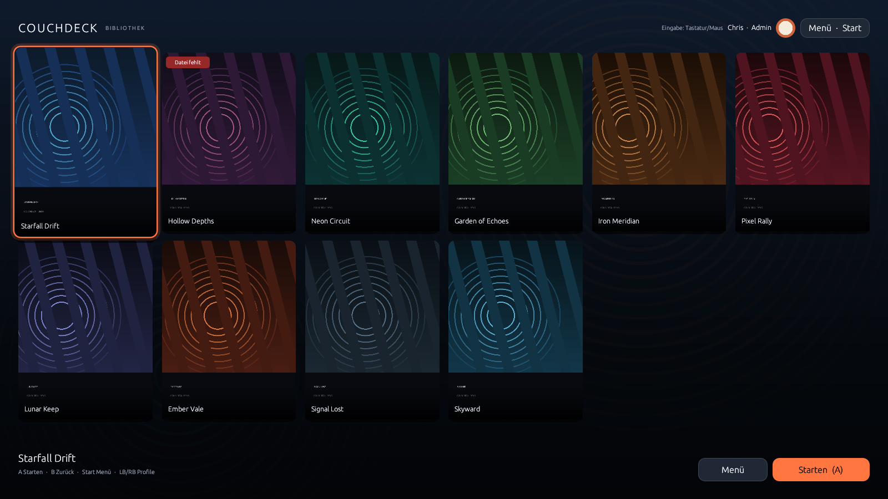

# CouchDeck

> **CouchDeck is a family-friendly, controller-first game launcher for Linux living-room PCs, independent of a specific distribution or desktop environment.**

It opens directly into a personal game library – no store, no news, no cloud, no overlay, and no game-platform accounts.

Primary desktop targets are **KDE Plasma, GNOME and XFCE** on Wayland or X11. Bazzite and SteamOS Desktop Mode are supported target platforms, but not technical requirements. Steam Gaming Mode/Gamescope is not a guaranteed target yet.

**Current version:** 0.4.0 · **Language:** English · [Deutsch](README-de.md)

The application UI is available in **German and English** via Fluent, with automatic locale detection and English as fallback. Some detailed documents under `docs/` are still in German.

Games are launched exclusively through existing `.desktop` files and `gio launch`. Cover images are managed separately from the desktop files; the original files are never modified.



## Features

- **Desktop-independent core**: no KDE-only runtime requirement. KDE Plasma, GNOME and XFCE on Wayland/X11 are the supported desktop targets; compositor-specific focus/minimize limitations are documented.
- **Native release packages**: portable x86_64 tar.gz and executable AppImage via GitHub Releases, with SHA-256 checksums, `ldd`/glibc runtime report, no root and no Rust compiler at install time.
- **Bilingual UI (de/en)** via Fluent: automatic detection from `LANGUAGE`/`LC_ALL`/`LC_MESSAGES`/`LANG`, English fallback, switchable live under Admin → Settings.
- **Fullscreen library** with a cover grid, 3:4 center crop, focus animation, and fallback order: custom cover → desktop icon → neutral tile.
- **Gamepad navigation** via `gilrs`: D-pad and left stick with deadzone, hold-repeat, debouncing, and hotplug. South = confirm/start, East = back, Start = menu. LB/RB (shoulder buttons) open the profile overview; profile switching happens there. Navigation is only processed while CouchDeck has window focus; connect/disconnect events are still handled, and stale input is discarded on focus changes.
- **Keyboard and mouse in parallel**: arrow keys, Enter/Space, Escape, M, F11, mouse click, and double-click.
- **Extended desktop discovery**: user XDG applications, all `XDG_DATA_DIRS`, Flatpak user/system exports, the real XDG desktop directory from `user-dirs.dirs`, CouchDeck-managed files and administrator-configured extra directories. XDG overlay priority, desktop IDs, symlinks, localized names and filenames with spaces are handled.
- **Desktop files**: arbitrary file import, preview of name, source, path, desktop ID and raw `Exec` content; support for `NoDisplay`, `Hidden`, `TryExec`, `Path`, `DBusActivatable`, `OnlyShowIn`, `NotShowIn`, categories, and localized names. `NoDisplay` entries can still be imported deliberately by an admin.
- **Search-path management**: Admin → Search paths shows automatic sources, lets admins add/remove extra directories with a controller-friendly folder picker, rescans in the background and shows missing/unreadable paths.
- **Launch via GIO**: only `gio launch /absolute/path.desktop`. `Exec=` is not interpreted for launching; the raw content is only shown and checked for diagnostics.
- **Custom artwork management**: cover, per-game background, global background, avatar, and **per-profile background** via a file picker. Profile backgrounds fall back to the global background; game backgrounds and existing data are preserved. Imports go to `$XDG_DATA_HOME/couchdeck/assets/`, thumbnail cache to `$XDG_CACHE_HOME/couchdeck/`.
- **Local profiles**: display name, role (admin/player), avatar, optional child-profile flag, daily time budget, per-profile background, and per-profile game visibility. No Linux accounts, no cloud. New imports are never automatically visible to child profiles.
- **Future-ready game model**: stable game ID plus origin (`desktop_entry`, `managed_desktop`, `steam`, `prism`, `manual`) and launch method (`gio_desktop`). Existing 0.3.1 libraries load with defaults.
- **Child profiles and time budgets**: accumulate active profile time while CouchDeck is running, show remaining time, warning toasts at 5/1 minutes, optional best-effort alert sound, and centrally block new game starts when the budget is exhausted. Running games are not force-closed. Profile switching, minimize, quit, and power actions require the admin PIN for child profiles.
- **Parent extra time**: “Request more play time” from the Start menu or the “Time budget exhausted” screen, admin PIN, then +5/+15/+30 or custom minutes. Extra time is stored per local calendar day, adds up, never changes the regular budget, and is resettable by an admin.
- **Admin area**: import/hide/remove/sort games, edit titles and artwork, manage profiles, per-profile visibility, settings, and PIN management.
- **Admin PIN**: Argon2id hash in a separate file with mode `0600`; input via keyboard and an on-screen numpad with a controller. Profile switching itself is not authentication; admin actions are unlocked separately when a PIN is set.
- **Steam Flatpak repair**: detects `Exec=steam steam://rungameid/ID`, never changes anything automatically, and after explicit confirmation creates a **separate managed** file using `flatpak run com.valvesoftware.Steam …`.
- **Prism Launcher**: import existing instance desktop files; CouchDeck can also generate a managed file using `flatpak run org.prismlauncher.PrismLauncher --launch INSTANCE_ID`. `INSTANCE_ID` is the instance folder, not the visible name.
- **Autostart (opt-in, desktop-aware)**: XDG autostart for the detected KDE, GNOME or XFCE session. It uses `OnlyShowIn=<detected desktop>` and `NotShowIn=gamescope`; unknown sessions and Steam Gaming Mode/Gamescope are never guessed. The entry can be managed via Admin → Settings or `install-user.sh --autostart`.
- **Minimize to desktop**: exits fullscreen first and then minimizes the window so the panel/taskbar remains reliably reachable on KDE, GNOME, XFCE and other desktops.
- **Power menu**: quit CouchDeck, reboot the system, or shut down the system – with a confirmation dialog and fixed `systemctl` calls (no shell).
- **Robust persistence**: atomic writes, backups for damaged files, no silent overwrites, logs under `$XDG_STATE_HOME/couchdeck/`. A per-user instance lock prevents autostart and manual start from running two UIs against the same library/time budget.

More screenshots: [Time budget exhausted](docs/screenshots/time-budget.png), [Profiles](docs/screenshots/profiles.png), [Library as a player profile](docs/screenshots/library-profile-mia.png), [Admin](docs/screenshots/admin.png), [Game editor](docs/screenshots/game-editor.png), [Import](docs/screenshots/import.png), [PIN pad](docs/screenshots/pinpad.png), [Launch overlay](docs/screenshots/launch.png), [Power menu](docs/screenshots/menu.png), [Autostart settings](docs/screenshots/autostart-settings.png), [Damaged data](docs/screenshots/corrupt-data.png).

## Requirements

- A supported Linux desktop session (KDE Plasma, GNOME or XFCE) on Wayland or X11. Bazzite and SteamOS Desktop Mode are target platforms; Steam Gaming Mode/Gamescope is not guaranteed.
- GLib/GIO (`gio`), a working OpenGL setup, and udev/libudev for `gilrs`; used on all desktop targets.
- systemd/logind with `systemctl` for reboot/shutdown on distributions that provide it; Polkit must allow the action for the active session. Other init systems are not supported for power actions.
- Rust stable **≥ 1.85** for building from source. Tested with Rust 1.89.
- For prebuilt releases: Linux x86_64 with glibc at least the version documented in the release `runtime-info.txt` (built on Fedora 42 / glibc 2.41), plus the normal KDE/GNOME/XFCE Wayland/X11 desktop libraries. No Rust toolchain is required.
- No root, no `rpm-ostree` layer, no Flatpak for CouchDeck itself.
- The respective Flatpaks must be installed on the host for Steam/Prism integration.

## Install from GitHub Releases (Linux desktop, no Rust required)

Prebuilt Linux x86_64 packages are published at
[github.com/saidsco/couchdeck-launcher/releases](https://github.com/saidsco/couchdeck-launcher/releases).
They are native applications: **no Flatpak sandbox, no root, no Rust compiler**.

Download these files from the latest release:

- `couchdeck-<version>-linux-x86_64.tar.gz`
- `CouchDeck-<version>-x86_64.AppImage`
- `SHA256SUMS`
- optional: `couchdeck-<version>-runtime-info.txt`

Verify the download (only downloaded files are checked):

```bash
sha256sum -c SHA256SUMS --ignore-missing
```

### Portable archive → user installation

```bash
tar -xzf couchdeck-<version>-linux-x86_64.tar.gz
./couchdeck-<version>-linux-x86_64/scripts/install-user.sh
# optional desktop-aware XDG autostart:
./couchdeck-<version>-linux-x86_64/scripts/install-user.sh --autostart
```

This installs the binary to `~/.local/bin/couchdeck`, plus the desktop menu entry,
icon and optional desktop-aware autostart entry. It **does not touch** the library, profiles,
PIN hash, artwork or settings under the XDG directories.

### AppImage

```bash
chmod +x CouchDeck-<version>-x86_64.AppImage
./CouchDeck-<version>-x86_64.AppImage
```

If FUSE is unavailable:

```bash
APPIMAGE_EXTRACT_AND_RUN=1 ./CouchDeck-<version>-x86_64.AppImage
```

The AppImage uses the same XDG data directories and does not install anything
system-wide.

### Update

Install the new release archive with the same `install-user.sh` command, or
replace the AppImage file. User data is stored separately and is preserved.
The admin PIN, profiles, imported games, covers/backgrounds and settings remain
unchanged.

### Uninstall

Keep the release archive, or download it again, then run:

```bash
./couchdeck-<version>-linux-x86_64/scripts/uninstall-user.sh
```

This removes binary, menu entry, icon and autostart only. To delete user data
as well:

```bash
./couchdeck-<version>-linux-x86_64/scripts/uninstall-user.sh --purge
```

The purge asks for explicit confirmation.

### Runtime requirements and glibc

The release is built in Fedora 42 with glibc 2.41; the current release binary references at most `GLIBC_2.39`. The generated
`runtime-info.txt` documents the build glibc, the maximum referenced GLIBC
symbol version and the `ldd` result. `ldd` on the release binary shows the
direct dependencies (glibc, `libm`, `libgcc_s`, `libudev`, `libcap`); the
Wayland/X11/GL libraries are loaded dynamically by the desktop session. On
your KDE/GNOME/XFCE session these are provided by the host. The AppImage deliberately
keeps host glibc, GPU drivers, Wayland/X11 and `libudev` to avoid
driver/ABI conflicts.

See [docs/RELEASE.md](docs/RELEASE.md) for build/release details and
[docs/BAZZITE-RELEASE-TEST.md](docs/BAZZITE-RELEASE-TEST.md) for the clean
Bazzite validation checklist.

## Building from source (Fedora/Bazzite Distrobox)

Use a Fedora base image that matches the **host Fedora version**, so the glibc inside the container is not newer than on the host.

```bash
# On the host
grep -E '^(NAME|VERSION_ID)=' /etc/os-release

# Example: host is Fedora 42
distrobox create \
  --name couchdeck-build \
  --image registry.fedoraproject.org/fedora-toolbox:42

# If the toolbox tag for your release is unavailable:
#   --image registry.fedoraproject.org/fedora:42

distrobox enter couchdeck-build
```

Inside the container:

```bash
sudo dnf install -y \
  cargo rust clippy rustfmt gcc gcc-c++ pkgconf-pkg-config \
  systemd-devel libxkbcommon-devel wayland-devel mesa-libGL-devel \
  libX11-devel libXcursor-devel libXrandr-devel libXi-devel

cd /path/to/couchdeck
cargo build --release
cargo test
cargo clippy --all-targets -- -D warnings
cargo fmt --check
```

If the Fedora `rust` package is older than 1.85, use rustup inside the container:

```bash
curl --proto '=https' --tlsv1.2 -sSf https://sh.rustup.rs | sh -s -- -y --profile minimal
source "$HOME/.cargo/env"
```

`Cargo.lock` is included and pins the tested versions (including `eframe 0.32.3`, `gilrs 0.11.2`, `image 0.25.10`, `argon2 0.5.3`, `fluent-bundle 0.16`, `chrono 0.4`, `fs2 0.4`).

## Rootless installation

After the release build on the **host** (not in the container), run this from the repository:

```bash
./scripts/install-user.sh
# optionally enable desktop-aware XDG autostart right away:
./scripts/install-user.sh --autostart
```

This installs:

- `~/.local/bin/couchdeck`
- `~/.local/share/applications/couchdeck.desktop`
- `~/.local/share/icons/hicolor/scalable/apps/couchdeck.svg`

Start it from the desktop application menu or with:

```bash
~/.local/bin/couchdeck
```

Development/debug:

```bash
~/.local/bin/couchdeck --windowed          # window instead of fullscreen
~/.local/bin/couchdeck --no-controller     # disable the gamepad thread
~/.local/bin/couchdeck --help
```

Uninstall without losing data:

```bash
./scripts/uninstall-user.sh
```

Complete removal of library, profiles, PIN hash, artwork, cache, and logs only after explicit confirmation:

```bash
./scripts/uninstall-user.sh --purge
```

## Controls

| Action | Controller | Keyboard/mouse |
|---|---|---|
| Move focus | D-pad / left stick | Arrow keys, mouse |
| Start / confirm | A (South) | Enter / Space, double-click |
| Back / close | B (East) | Escape |
| Menu | Start | M |
| Switch profile | LB/RB (opens profile view; switch there) | PageUp/PageDown |
| Minimize to desktop | Menu → Minimize to desktop | Menu |
| Toggle fullscreen | – | F11 |
| Request more play time (child profile) | Start → Request more play time | Menu |
| Reboot / shut down system | Menu → System … | Menu |
| Quit CouchDeck | Menu → Quit CouchDeck | Ctrl+Q |

The library shows only covers, titles, and a reduced action bar on focus. LB/RB open the profile overview from the library; switching happens there.

## Autostart, kiosk mode, and system actions

CouchDeck is a normal desktop application, not a replacement desktop session. Autostart is XDG-based and opt-in. The generated entry is bound to the detected session:

- `OnlyShowIn=KDE;`, `OnlyShowIn=GNOME;` or `OnlyShowIn=XFCE;`
- `NotShowIn=gamescope;`
- `X-CouchDeck-Desktop=<detected desktop>`

Unknown desktop strings and Steam Gaming Mode/Gamescope produce no autostart entry. If a stale entry exists for another desktop, Admin → Settings reports it as inactive and offers removal. The installer only writes autostart when invoked with `--autostart` and a supported desktop session is detected.

- **Enable autostart**: Admin → Settings → “Start automatically on login (KDE, GNOME or XFCE)”. Alternatively `./scripts/install-user.sh --autostart` from a supported desktop session.
- **Autostart file**: `$XDG_CONFIG_HOME/autostart/couchdeck.desktop` (normally `~/.config/autostart/couchdeck.desktop`).
- **Fullscreen overlay**: On startup, the window opens borderless in fullscreen. The desktop remains active in the background.
- **To desktop**: The “Minimize to desktop” menu item exits fullscreen first and then minimizes the window. CouchDeck can be restored from the taskbar. If a Wayland compositor ignores the minimize request, the window is already in windowed mode and remains reachable via taskbar/Alt+Tab.
- **Quit**: “Quit CouchDeck” in the Start menu only exits the launcher, not already running games.
- **Reboot / shut down**: CouchDeck asks for confirmation and then calls `systemctl --no-block --no-wall reboot` or `systemctl --no-block --no-wall poweroff`. Authorization is handled by systemd/logind via Polkit; a Polkit prompt may appear.

Autostart is a deliberate opt-in feature and is removed by `scripts/uninstall-user.sh`. The library, profiles, and artwork remain intact.

## First steps

1. **Open the admin area**: Menu → Admin Area. On first start, a local admin profile `Player 1` exists. Name and avatar can be changed under Admin → Profiles.
2. **Import a game**: Admin → Games → *Import desktop file*. Name, path, and raw `Exec` content are shown before approval. Alternatively, choose any file via the file browser.
3. **Set a cover**: Select a game → *Choose cover*. The image is copied and stored as a custom override; `Icon=` in the `.desktop` file remains unchanged.
4. **Set an admin PIN** (recommended): Admin → PIN & Security → *Set PIN*. The PIN is a local UI lock, not an operating-system security boundary.
5. **Start**: Press A/Enter in the library. CouchDeck hands the file to GIO and deliberately does not show a “game is running” status.

## Steam and Prism

### Steam as Flatpak

An existing shortcut with `Exec=steam steam://rungameid/12345` is detected in the game editor and under Admin → Steam/Prism. CouchDeck does not modify the original file. After confirmation, a separate file is created under `$XDG_DATA_HOME/couchdeck/managed-desktop/`:

```ini
Exec=flatpak run com.valvesoftware.Steam steam://rungameid/12345
```

The new entry is additionally added to the library; the original entry remains. If `com.valvesoftware.Steam` is not installed, the repair is refused.

### Prism Launcher

Existing `.desktop` files with:

```ini
Exec=flatpak run org.prismlauncher.PrismLauncher --launch INSTANCE_ID
```

can be imported directly. During import, CouchDeck verifies that the instance folder exists:

- `~/.var/app/org.prismlauncher.PrismLauncher/data/PrismLauncher/instances/<ID>`
- `~/.local/share/PrismLauncher/instances/<ID>`
- `~/.var/app/org.prismlauncher.PrismLauncher/.local/share/PrismLauncher/instances/<ID>`

`INSTANCE_ID` is the **folder name**, not the visible instance name. Under Admin → Steam/Prism, existing instances can be selected and a managed desktop file can be created. The cover is then set like for any other entry and is completely independent of the desktop icon.

Example files are in `examples/`: `prism-minecraft.desktop`, `steam-game-flatpak.desktop`, `steam-game-original.desktop`, and `library.example.json`.

## Data format and locations

| Purpose | Path |
|---|---|
| Settings (incl. extra search dirs) | `$XDG_CONFIG_HOME/couchdeck/settings.toml` |
| XDG autostart | `$XDG_CONFIG_HOME/autostart/couchdeck.desktop` |
| Instance lock | `$XDG_RUNTIME_DIR/couchdeck.lock` (fallback `$XDG_STATE_HOME/couchdeck/instance.lock`) |
| Library/profiles/games | `$XDG_DATA_HOME/couchdeck/library.json` |
| Daily usage/extra time | `$XDG_DATA_HOME/couchdeck/timekeeping.json` |
| PIN hashes | `$XDG_DATA_HOME/couchdeck/secrets.json` (mode `0600`) |
| Imported images | `$XDG_DATA_HOME/couchdeck/assets/{covers,backgrounds,avatars}/` |
| Managed desktop files | `$XDG_DATA_HOME/couchdeck/managed-desktop/` |
| Thumbnail cache | `$XDG_CACHE_HOME/couchdeck/thumbnails/` |
| Logs | `$XDG_STATE_HOME/couchdeck/couchdeck.log` |

Details: [docs/DATA-FORMAT.md](docs/DATA-FORMAT.md), [desktop/discovery architecture](docs/DESKTOP-DISCOVERY.md) and [desktop test matrix](docs/DESKTOP-TEST-MATRIX.md) (currently in German).

## Security model

- CouchDeck **only** launches files that an admin has explicitly imported. During import, name, path, and `Exec` are shown.
- `Exec=` is never executed by CouchDeck or split into arguments for launching. The file is passed unchanged to `gio launch`; the raw content is only displayed and checked for diagnostic hints.
- The admin area and all modification actions are only visible to admin profiles; child profiles never get admin UI access.
- The PIN protects against accidental UI changes. It is **not a real OS security boundary**: anyone with access to the same Linux user account can modify the JSON files directly. Use separate Linux accounts for real isolation.
- Power actions are only triggered after a confirmation dialog. Fixed, argument-separated `systemctl` calls are used; no shell, no arbitrary command chaining.
- Parental time limits are a family convenience, **not an OS-level sandbox**. A user who can kill the process, switch to a TTY, edit files in the same Linux account, or use compositor shortcuts is outside the protection model.
- No network dependency, no cloud, no telemetry, no external downloads.

## Architecture

```
main.rs        CLI, logging, eframe startup, viewport
app.rs         state machine, navigation, actions, persistence orchestration
model.rs       Library/Profile/GameEntry/Settings/AdminSecrets
storage.rs     XDG persistence, atomic writes, backups, migration
paths.rs       XDG resolution, application/icon paths
desktop.rs     desktop parsing, discovery, icon resolution, Steam/Prism diagnostics
launch.rs      GIO launch in a background thread, error diagnostics
system.rs      system actions, systemctl reboot/shutdown, Polkit error handling
timekeeping.rs daily usage, extra minutes, day rollover, persistence
i18n.rs        Fluent bundles, locale detection, live language switching
sound.rs       best-effort warning sound via system players
controller.rs  gilrs thread, deadzone, repeat, hotplug, input normalization
artwork.rs     image import, center crop, thumbnail cache, textures
ui/            library, profiles, admin, dialogs/overlays, time dialogs
```

Data flow: `UI → AppState → Library/Profiles → GIO (gio launch)`.

## Known limitations / still to be tested on target hardware

- **Desktop target testing**: Development and automated tests ran on Manjaro/KDE/Wayland; the packages are built and smoke-tested in a clean Fedora 42 container. KDE/Wayland is only partially tested. GNOME/Wayland, XFCE/X11, SteamOS Desktop Mode, full Wayland/X11 fullscreen behavior, NVIDIA rendering and real controller hotplug remain open; see `docs/DESKTOP-TEST-MATRIX.md`. The clean Bazzite release checklist is in `docs/BAZZITE-RELEASE-TEST.md`.
- **Controller hardware**: an 8BitDo Ultimate was detected and usable on Manjaro/KDE/Wayland (USB/Bluetooth mode details still to be recorded). Xbox/PlayStation controllers, GNOME/XFCE and Bazzite hotplug/reconnect remain to be verified. `--no-controller` and the “no controller found” case were tested.
- **No game lifecycle tracking**: `gio launch` is only a start command. CouchDeck does not reliably know whether a game is running or when it ends. Steam/Prism may continue running in the background. Time budgets therefore measure **active profile time while CouchDeck is running**, not actual game process time; game detection is a later step.
- **Time-budget edge cases**: usage is saved every 30 seconds, on warnings, on grants, on profile switches, and on exit. A hard kill/power loss can lose up to the last interval. If the launcher is not running, no time is counted. The child guard covers app-level minimize/quit/power/profile switching and best-effort WM close/minimize paths, but cannot prevent TTY switching, killing the process, or editing files in the same Linux account.
- **Notifications/alarm best effort**: warnings are shown in the CouchDeck window. Under Wayland there is no guaranteed overlay above fullscreen games; the optional sound uses `canberra-gtk-play`/`paplay`/`pw-play`/`aplay` if available and is silently skipped otherwise.
- **Focus after game start/exit**: The desktop/compositor is expected to bring the game window to the foreground; behavior differs on Wayland. CouchDeck never terminates games and offers an explicit “Minimize to desktop”.
- **SVG desktop icons** are not rasterized (no SVG decoder is bundled). PNG/WebP/JPEG icons and custom covers work; otherwise the neutral tile is used.
- **No cover scraping, no Steam API, no store integration**, no automatic search.
- **Favorites**: the data field exists, but a favorites UI is not implemented in the MVP.
- **Prism management**: generating a managed file requires the Prism Flatpak. Native Prism installations can be imported if a matching `.desktop` file exists.
- **Steam Input**: not tested with Steam Input active. Steam may create additional virtual controllers; if double input occurs, disable Steam Input for the launcher.
- **Autostart**: session detection and entry generation are unit-tested; real KDE/GNOME/XFCE login sessions and SteamOS Desktop Mode remain to be verified.
- **Fullscreen minimize**: the “leave fullscreen → minimize” flow is implemented, but `ViewportCommand::Minimized` behavior depends on the Wayland compositor and remains untested on GNOME, XFCE and Bazzite.
- **System power**: shutdown/reboot uses `systemctl` and requires a suitable Polkit permission. The actual action was not executed in the development environment to avoid shutting down the system; command construction, confirmation dialog, and error handling were tested.
- **Multiple instances**: a per-user `flock` lock prevents a second independent UI. The lock is released automatically on process exit/crash; a stale lock file does not block startup.
- **No Flatpak for CouchDeck itself** in v0.4.0, as specified. Release packaging consists of a portable tar.gz and a native AppImage, not RPM/Flatpak.
- **Supported desktop sessions** are KDE Plasma, GNOME and XFCE under Wayland or X11; Steam Gaming Mode/Gamescope is not a guaranteed target. Gamescope/Steam Input conflicts have not been tested.

## Tests and acceptance

- Unit/integration tests: **75 tests passing** (`cargo test`: 73 unit tests including timekeeping, i18n, parent-PIN/switch/start guards, plus 2 GIO integration tests).
- `cargo clippy --all-targets -- -D warnings`: clean.
- `cargo fmt --check`: clean.
- Release build: `cargo build --release --locked`.
- UI smoke tests and measurements: [docs/TEST_REPORT.md](docs/TEST_REPORT.md) (currently in German).
- Acceptance matrix: [docs/ACCEPTANCE.md](docs/ACCEPTANCE.md) (currently in German).

## Changelog

- **v0.4.0**: desktop-independent KDE/GNOME/XFCE support, safe XDG autostart, extended XDG/Flatpak/desktop-directory discovery, admin search paths, grouped import overview, future-ready game origins and single-instance lock.
- **v0.3.1**: GitHub release automation: portable x86_64 archive, native AppImage, SHA256SUMS, ldd/glibc runtime reports and no-Rust installation.
- **v0.3.0**: German/English Fluent UI with live switching, per-profile backgrounds, child profiles with daily time budgets, parent extra-time grants, central launch blocking, warning sounds.
- **v0.2.5**: controller focus gating/input-buffer reset, correct LB/RB shoulder mapping, system actions moved to `system.rs`.
- **v0.2.0**: KDE autostart, “Minimize to KDE”, shutdown/reboot power menu, more robust quit/fullscreen behavior.
- **v0.1.0**: first MVP with library, profiles, admin PIN, artwork, and Steam/Prism integration.

Details: [CHANGELOG.md](CHANGELOG.md).

## License

Apache License 2.0. See [LICENSE](LICENSE) and [NOTICE](NOTICE).
